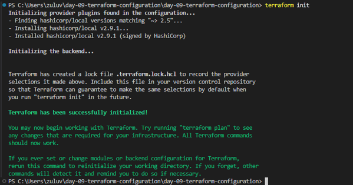
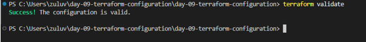
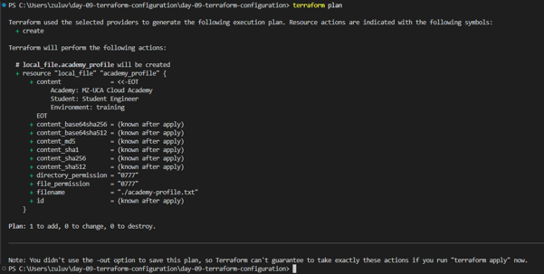
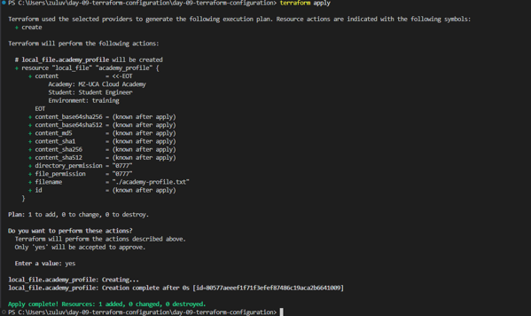
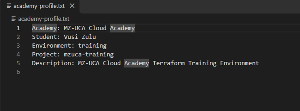

# MZ‑UCA Academy Profile and Policy Reader

## Project Objective
This project demonstrates Terraform variables, outputs, locals, data sources, and a managed local file.

## Tools Used
- Terraform
- HashiCorp Local Provider
- Visual Studio Code
- Terminal

## Resources Managed
- local_file.academy_profile

## Data Sources Used
- data.local_file.academy_policy
  
## Initialization

This screenshot confirms successful initialization of provider plugins, verifying that Terraform is ready to manage resources.

## Validation

This screenshot shows the output of `terraform validate`, confirming that all configuration files are syntactically correct and ready for execution.

## Execution

This screenshot displays the `terraform plan` output, outlining the resources Terraform will create and confirming the configuration logic.

This screenshot shows the `terraform apply` output, demonstrating successful resource creation and generation of the academy profile file.

## Evidence

### Terraform Version

### Terraform Init

### Terraform Validate

### Terraform Plan

### Terraform Apply

### Academy Profile Output

## Troubleshooting Guide

### Problem 1 — Terraform is not recognised
**Possible cause:** Terraform is not installed or not available through your system PATH.  
**What to do:**
1. Check the Terraform installation.  
2. Open a new terminal after correcting the installation.  
3. Run `terraform version` again.

---

### Problem 2 — Provider initialisation fails
**Possible cause:** Network connection problem, provider registry issue, or incompatible provider configuration.  
**What to do:**
1. Read the complete error message.  
2. Check your internet connection.  
3. Confirm that `versions.tf` contains the correct provider source.  
4. Run `terraform init` again.

---

### Problem 3 — Terraform reports an invalid reference
**Possible cause:** A variable, resource, or local value has been misspelled.  
**What to do:**
1. Check the exact name.  
2. Confirm that the required file exists.  
3. Compare the reference against its declaration.  
4. Run `terraform validate` again.  
💡 Remember that `var.student_name` and `local.project_name` refer to different types of values.

---

### Problem 4 — Terraform cannot find the policy file
**Possible cause:** The file is missing or the path is incorrect.  
**What to do:**
1. Confirm that the input directory exists.  
2. Confirm that `academy-policy.txt` is inside it.  
3. Check spelling and capitalisation.  
4. Run `terraform plan` again.  
📘 The data source requires the input file to exist.

---

### Problem 5 — The generated file has unexpected content
**Possible cause:** The local expression, variable value, or file content was not updated as expected.  
**What to do:**
1. Open `variables.tf`.  
2. Open `locals.tf`.  
3. Open `main.tf`.  
4. Check that `main.tf` uses `local.profile_content`.  
5. Run `terraform plan`.  
6. Apply the changes and inspect the file again.

---

### Problem 6 — Terraform reports no changes
**Explanation:** This is not necessarily an error. If the managed file already matches the configuration, Terraform correctly reports that no changes are required.  
If you expected a change, check whether you actually modified a value used by the resource.

---

### Problem 7 — Terraform state is missing or out of sync
**Possible cause:** The state file `terraform.tfstate` is missing or corrupted.  
**What to do:**
1. Do not manually edit or delete the state file.  
2. Inspect your working directory and the error message before taking corrective action.  
3. If state is lost, recreate or import resources carefully using Terraform’s recovery procedures.

